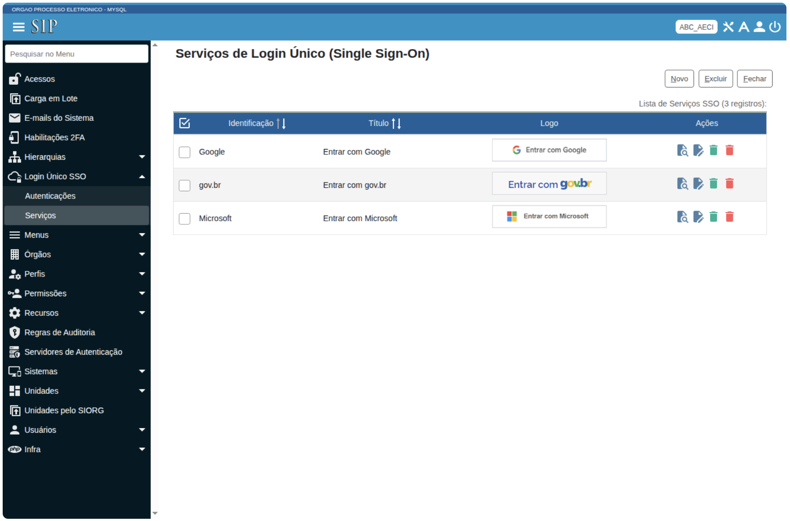
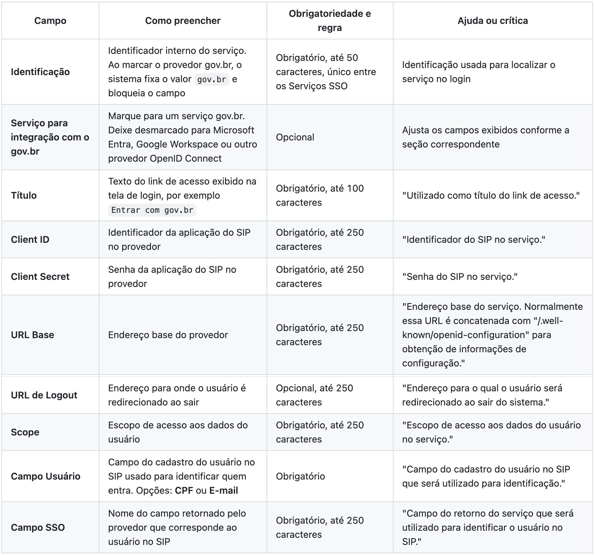
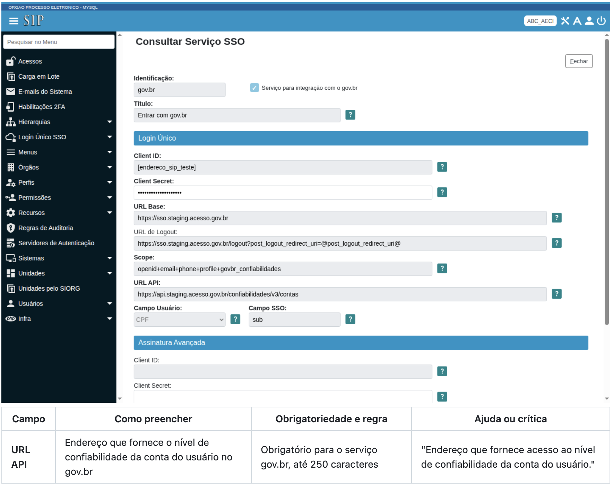
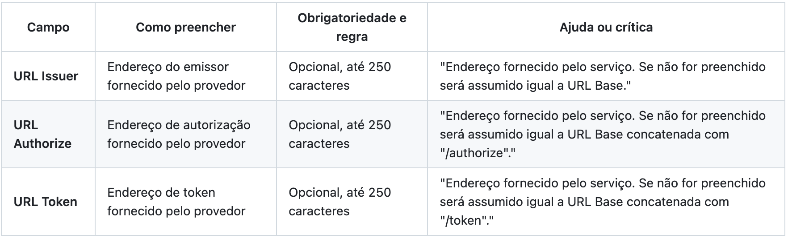
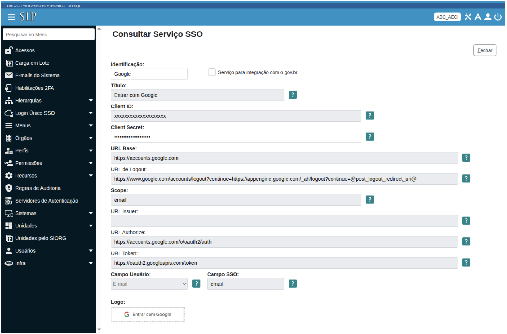
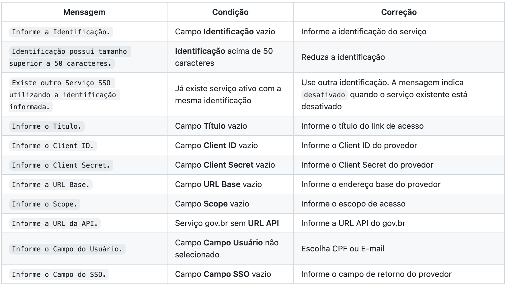
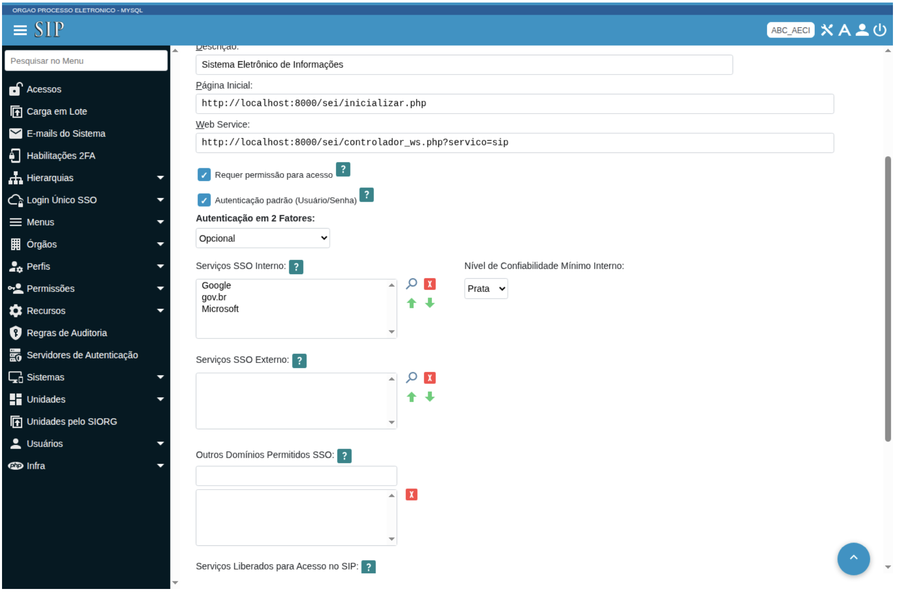
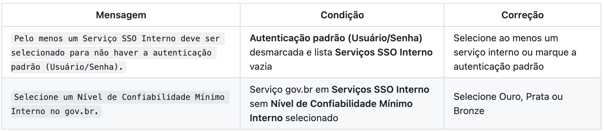
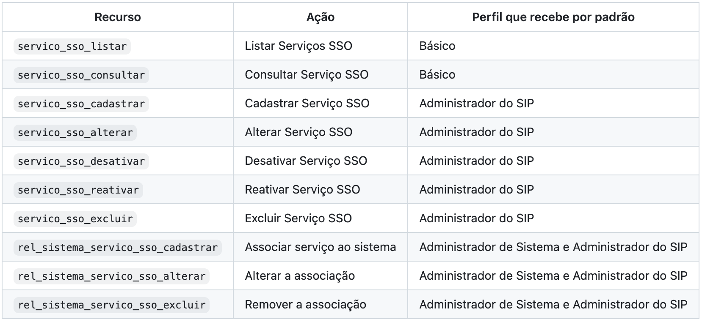

Manual de administração do login por provedores de identidade no SEI
=====================================================================

Público: administradores do SIP responsáveis por configurar o acesso ao SEI por Gov.br, Microsoft Entra e Google Workspace.

Visão geral do login por provedores de identidade
+++++++++++++++++++++++++++++++++++++++++++++++++

A autenticação no SEI é realizada por meio do Sistema de Permissões - SIP. O login por provedor externo, por sua vez, usa o recurso de Login Único (SSO) do SIP, implementado sobre o protocolo OpenID Connect.

Cada provedor de identidade é cadastrado como um **Serviço SSO**. Gov.br, Microsoft Entra e Google Workspace são configurações do mesmo mecanismo, com endereços e escopos próprios de cada provedor.

O Serviço SSO só aparece na tela de login depois de associado a um sistema. A associação define se o provedor vale para o acesso Interno, o acesso Externo, ou ambos.

O acesso Externo do SEI oferece apenas o provedor gov.br. O botão aparece quando o serviço gov.br está na lista **Serviços SSO Externo** do sistema e o ambiente habilita essa opção. Microsoft Entra e Google Workspace aplicam-se ao acesso Interno.

Antes de começar
++++++++++++++++

Reúna os dados de registro da aplicação no provedor antes de cadastrar o Serviço SSO: **Client ID**, **Client Secret**, endereço base do serviço e escopo de acesso. Para Microsoft Entra e Google Workspace, obtenha também os endereços de autorização e de token.

Registre no provedor a URL de retorno do SIP, o endereço do SIP seguido de ``/login_sso.php``, para onde o provedor redireciona o usuário após autenticar.

Para cadastrar e manter Serviços SSO, use um login com o perfil Administrador do SIP. Para associar o serviço a um sistema, use um login com o perfil Administrador de Sistema. A seção `Perfis e permissões <https://github.com/pengovbr/pen-docs/issues/45#perfis-e-permiss%C3%B5es>`_ detalha os recursos.

Como cadastrar um Serviço SSO
+++++++++++++++++++++++++++++

O cadastro de Serviços SSO fica no menu **Login Único SSO**, item **Serviços**.

1. Acesse **Login Único SSO > Serviços**.

A tela **Serviços de Login Único (Single Sign-On)** lista os Serviços SSO já cadastrados, com as colunas **Identificação**, **Título**, **Logo** e **Ações**. A coluna **Logo** mostra o botão como ele aparece na tela de login.

2. Selecione **Novo** para abrir o formulário **Novo Serviço SSO**.
3. Preencha os campos conforme o provedor e selecione **Salvar**.

O sistema confirma com a mensagem ``Serviço SSO "..." cadastrado com sucesso.``, com o título do serviço entre as aspas, e volta para a lista.

As telas de cada tipo de provedor aparecem nas seções `Serviço para integração com o gov.br <https://github.com/pengovbr/pen-docs/issues/45#servi%C3%A7o-para-integra%C3%A7%C3%A3o-com-o-govbr>`_ e `Serviço de outro provedor: Microsoft Entra e Google Workspace <https://github.com/pengovbr/pen-docs/issues/45#servi%C3%A7o-de-outro-provedor-microsoft-entra-e-google-workspace>`_.

Campos do Serviço SSO
---------------------

O campo **Campo Usuário** liga a conta do provedor ao cadastro do SIP. Ao escolher **CPF**, o SIP identifica o usuário pelo CPF; ao escolher **E-mail**, pelo e-mail. O valor que vem do provedor é lido do campo informado em **Campo SSO**.

Serviço para integração com o gov.br
------------------------------------

Ao marcar **Serviço para integração com o gov.br**, o formulário fixa a **Identificação** em `gov.br`, exibe o campo **URL API** e a seção **Assinatura Avançada**, e oculta os campos **URL Issuer**, **URL Authorize** e **URL Token**, porque o SIP usa os endereços padrão do gov.br.

A seção **Assinatura Avançada** reúne os dados do serviço de Assinatura Avançada do gov.br (**Client ID**, **Client Secret**, **URL Base** e **URL API**), todos opcionais. A assinatura por SSO está fora do alcance deste manual.

Serviço de outro provedor: Microsoft Entra e Google Workspace
-------------------------------------------------------------

Com o campo **Serviço para integração com o gov.br** desmarcado, o formulário mantém a **Identificação** editável, exibe os campos **URL Issuer**, **URL Authorize** e **URL Token**, e oculta a **URL API** e a seção **Assinatura Avançada**. Use esse formato para Microsoft Entra, Google Workspace e demais provedores OpenID Connect.

Para o **Microsoft Entra**, informe em **URL Base** o endereço do locatário, e preencha **URL Authorize** e **URL Token** com os endereços de autorização e de token do Entra. Use o **Client ID** e o **Client Secret** do registro do aplicativo no Entra e o **Scope** com os escopos de identificação da conta.

Para o **Google Workspace**, informe os endereços de autorização e de token do Google em **URL Authorize** e **URL Token**, com o **Client ID** e o **Client Secret** das credenciais do projeto no Google e o **Scope** correspondente. Confirme no provedor os valores exatos dos endereços e escopos, porque o manual não define os endereços de produção de cada provedor.

A imagem abaixo mostra a configuração de um provedor que não é o gov.br, com os campos **URL Issuer**, **URL Authorize** e **URL Token** visíveis. O exemplo usa o Google Workspace, com **URL Base** ``https://accounts.google.com``, **URL Authorize** ``https://accounts.google.com/o/oauth2/auth`` e **URL Token** ``https://oauth2.googleapis.com/token``.

Logo do provedor
----------------

O campo **Logo** aceita o envio de uma imagem no formato PNG, usada como botão do provedor na tela de login. O tamanho de exibição é 200 por 40 pixels.

Sem logo, a tela de login mostra o **Título** do serviço como um link de texto. Para remover um logo já enviado, use o ícone de remoção ao lado da imagem.

Críticas ao salvar o Serviço SSO
--------------------------------

Como associar o Serviço SSO ao sistema
++++++++++++++++++++++++++++++++++++++

O provedor só aparece na tela de login após associar o Serviço SSO ao sistema. A associação é feita no cadastro do sistema, na tela **Sistemas**, e exige o perfil Administrador de Sistema.

1. Acesse a tela **Sistemas** e selecione o sistema desejado para alteração.
2. No campo **Serviços SSO Interno**, adicione pelo botão de busca os provedores que valem para o acesso Interno e use as setas para definir a ordem dos botões no login.
3. No campo **Serviços SSO Externo**, adicione pelo botão de busca os provedores que valem para o acesso Externo.
4. Defina o campo **Autenticação padrão (Usuário/Senha)** conforme a necessidade e selecione **Salvar**.

O campo **Autenticação padrão (Usuário/Senha)** controla a exibição dos campos Usuário e Senha na tela de login, com a ajuda `Indica se os campos Usuário/Senha devem ser exibidos na tela de login. Se estiver desmarcado obrigará a escolha de pelo menos um Serviço SSO Interno.`

A ordem dos serviços na lista define a ordem dos botões na tela de login.

A área de Serviços SSO do cadastro do sistema reúne as listas **Serviços SSO Interno** e **Serviços SSO Externo**, com um botão de busca para adicionar provedores e setas para ordená-los, além do campo **Autenticação padrão (Usuário/Senha)**.

Quando a lista **Serviços SSO Interno** inclui um serviço gov.br, o formulário exibe o campo **Nível de Confiabilidade Mínimo Interno**, com as opções **Ouro**, **Prata** e **Bronze**, que correspondem aos níveis de conta do gov.br. O campo é obrigatório nesse caso.

Com essa configuração, a tela de login do SEI mostra os botões **Entrar com Google**, **Entrar com gov.br** e **Entrar com Microsoft**, nessa ordem, abaixo do botão **ACESSAR**.

As críticas abaixo surgem ao salvar o sistema.

Como consultar, alterar, desativar e excluir Serviços SSO
+++++++++++++++++++++++++++++++++++++++++++++++++++++++++

Na tela **Login Único SSO > Serviços**, cada registro oferece as ações conforme a permissão do perfil.

Use **Consultar** para abrir o serviço em modo somente leitura, com os campos desabilitados.

Use **Alterar** para editar o serviço. O sistema confirma com ``Serviço SSO "..." alterado com sucesso.``, com o título do serviço entre as aspas.

Use **Desativar** para suspender o serviço sem apagá-lo. Um serviço desativado mantém a identificação reservada, por isso a crítica de identificação duplicada indica quando o serviço existente está desativado.

Use **Excluir** para remover o serviço. Selecione os registros e confirme a exclusão.

A barra da lista ainda oferece **Gerar Planilha**, para exportar a tabela, e **Transportar**, para levar a seleção a outra tela.

Perfis e permissões
-------------------

O menu **Login Único SSO** reúne os itens **Serviços**, ligado ao recurso ``servico_sso_listar``, e **Autenticações**, ligado ao recurso ``login_sso_listar``, que lista os registros de tentativas de login por provedor.
